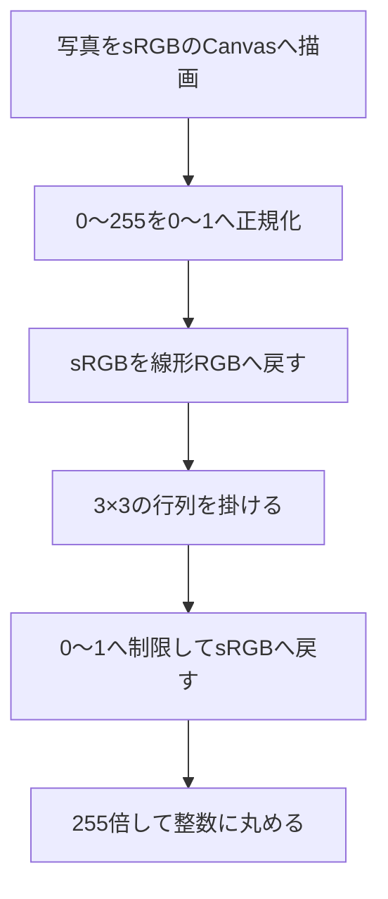

# わんにゃん視覚の色変換

このアプリは、写真の色を変えて「人と違う色の見分け方」を考えるための道具である。**犬猫が実際に見ている映像の完全再現ではない。** 人の二色型色覚のモデルを教育用の代理として使っている。

## 赤を消す加工ではない

人の多くは、異なる波長域に感度を持つ3種類の錐体の信号から色を区別する。犬では3頭を調べた行動実験が二色覚を支持し、猫では2頭の色弁別実験が二色覚の中性点を示している。「二色」は2色だけで世界を描くという意味ではなく、色の区別に使える信号の種類が違うという意味だ。赤い物体が消えるわけでもない。[犬の研究（Neitzら、1989）](https://doi.org/10.1017/S0952523800004430)、[猫の研究（Clark・Clark、2016）](https://pubmed.ncbi.nlm.nih.gov/27720709/)

画面のRGBは動物の錐体の信号そのものではない。このアプリでは、RGBの赤成分をゼロにする代わりに、**色同士の区別が変わるように3成分をまとめて変換する**。

## 採用したモデル

Machado・Oliveira・Fernandes（2009）の人の色覚モデルから、deuteranopia（2型二色覚）の終端行列を使う。このモデルの「強度1.0」は人の二色型色覚を表す設定であり、「犬の視覚を100%再現」という意味ではない。[原論文 DOI](https://doi.org/10.1109/TVCG.2009.113)

犬猫は人の赤緑色覚特性に似た色の区別を持つが、同一ではない。[Tufts大学獣医学部の解説](https://vet.tufts.edu/news-events/news/eye-care-pets)も、この違いを明記している。現行版で犬・猫に同じフィルターを使うのは、通常の写真から種ごとの差を正確に校正できないための実装上の選択だ。切替時に変わるのは説明とラベルであり、変換行列は変わらない。

## 1画素の計算手順

### 1. 光の強さに比例する値へ戻す

写真のsRGB値は、光の強さに比例する数値ではない。例えば128は255の約半分だが、線形化すると約0.216になる。行列の前にこの非線形な符号化を戻す。各チャンネルを255で割った値を $c$ とすると、

$$
L(c)=
\begin{cases}
c/12.92 & c\leq0.04045\\
((c+0.055)/1.055)^{2.4} & c>0.04045
\end{cases}
$$

これは[W3CのsRGB変換式](https://www.w3.org/TR/css-color-4/#color-conversion-code)の0〜1の範囲に対応する。sRGB値へ直接行列を掛ける場合とは結果が異なる。

### 2. 線形RGBに行列を掛ける

入力を縦ベクトルとして、次を計算する。

$$
\begin{bmatrix}R'\\G'\\B'\end{bmatrix}
=
\begin{bmatrix}
0.367322 & 0.860646 & -0.227968\\
0.280085 & 0.672501 & 0.047413\\
-0.011820 & 0.042940 & 0.968881
\end{bmatrix}
\begin{bmatrix}L(R/255)\\L(G/255)\\L(B/255)\end{bmatrix}
$$

例えば出力の赤成分は、入力の赤・緑・青すべてから決まる。負の係数があるため、計算値が画面で表示できる範囲を外れることもある。係数は[DaltonLensのMachado実装](https://github.com/DaltonLens/DaltonLens-Python/blob/master/daltonlens/simulate.py)の `Deficiency.DEUTAN`・`10` と照合した。同実装も線形化したRGBへ行列を適用している。

### 3. 表示用の値へ戻す

各成分を $u=\min(1,\max(0,c'))$ で0〜1に制限し、次の式でsRGBへ戻す。

$$
S(u)=
\begin{cases}
12.92u & u\leq0.0031308\\
1.055u^{1/2.4}-0.055 & u>0.0031308
\end{cases}
$$

最後に `Math.round(255 * S(u))` を使う。範囲外の値を端へそろえる処理は、画面に収めるためのクリップであり、動物の視覚特性を新しく計算しているわけではない。

## 実装で確かめられる例

不透明な単色画素を変換した結果は次の通り。これは**このアプリの計算結果**であり、動物に測定した色名ではない。

| 入力RGB | 出力RGB | 出力の16進表記 |
|---|---|---|
| 赤 `(255, 0, 0)` | `(163, 144, 0)` | `#A39000` |
| 緑 `(0, 255, 0)` | `(239, 214, 58)` | `#EFD63A` |
| 青 `(0, 0, 255)` | `(0, 61, 251)` | `#003DFB` |
| 灰色 `(128, 128, 128)` | `(128, 128, 128)` | `#808080` |
| 茶色 `(128, 64, 32)` | `(97, 87, 31)` | `#61571F` |

純赤では線形化後も `(1,0,0)` なので、行列の第1列 `(0.367322, 0.280085, -0.011820)` が得られる。青成分を0へ制限してsRGBへ戻すと `(163,144,0)` になる。赤と緑の例は似た黄系へ移るが、明るさまで同一になるとは限らない。

行列の各行の和はほぼ1で、現行の8ビット計算では黒から白まで256段階の灰色が保たれる。数値例、灰色、入力を壊さないこと、透明度の保持は[テスト](../tests/wannyan.test.mjs)で検査している。これは計算の再現性の検査であり、犬猫による知覚の妥当性検証ではない。

## 写真処理と実装の対応

- [vision.js](../public/vision.js)：`decode`・`MATRIX`・`encode`・`transformPixels` が上記の計算を担当する。入力8ビット値の線形化を256要素の表へ先に計算している。同じ写真・設定なら結果は同じで、生成AIや外部APIは使わない。
- [app.js](../public/app.js)：縦横比を維持して処理長辺を1600px以下にし、白く塗ったsRGB Canvasへ写真を描いてから変換する。透明部分は先に白地へ合成されるため、画面の「元の写真」と変換後を同じ背景で比べられる。変換関数単体は入力のalphaを保持するが、通常のアプリ入力は白地への合成後である。
- 比較スライダーは元画像と変換画像を見せる境界を動かす。色覚モデルの強度を変える操作ではない。

## 再現できないこと

普通のRGB写真は、撮影時の光の全スペクトルや紫外線を保存していない。同じRGBでも元の光の分布が違う場合があり、動物の受容器の応答まで一意には求められない。定量的な動物視覚の研究では、カメラ・照明・分光感度などを校正する。[Troscianko・Stevens（2015）の画像校正手法](https://doi.org/10.1111/2041-210X.12439)

本アプリは視力、暗視、視野、動きへの反応、脳内の主観、個体差を再現しない。猫だけをぼかすなどの根拠のない演出も入れていない。端末の表示や撮影条件でも結果の印象は変わる。「赤いおもちゃが、この近似では背景と似た色になる」という観察には使えるが、「実際の犬には絶対に見つからない」という判定には使えない。

確認日：2026年11月7日。係数と処理順は公開コード・W3C資料で確認した。[モデル作者の係数ページ](https://www.inf.ufrgs.br/~oliveira/pubs_files/CVD_Simulation/CVD_Simulation.html)は取得時にタイムアウトしたため、そこでの直接再確認はできていない。犬・猫の原論文については公開抄録の範囲を用い、全文通読とは扱っていない。出典・第三者コードの許諾表示は[NOTICE.txt](../public/NOTICE.txt)にある。
